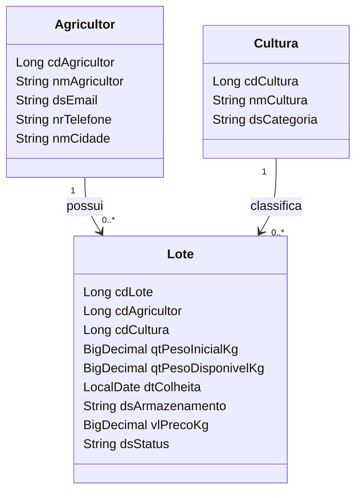
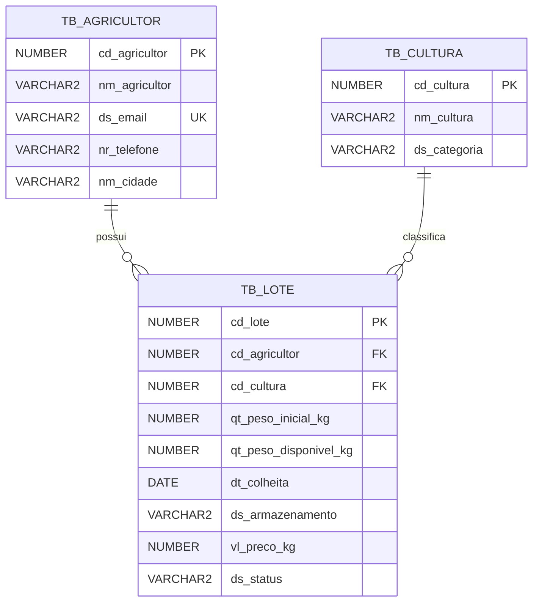

# ColheitaSmart — documentação técnica preliminar

## Identificação e links pendentes
Integrantes, RMs e turmas: preencher pelo grupo.
API no Render: pendente de publicação. Vídeo: pendente do front integrado.
Este texto é a base para o PDF final, não uma evidência de deploy ou integração.

## Solução
Apoio a pequenos agricultores no acompanhamento dos lotes após a colheita,
reduzindo a desorganização dos registros e apoiando decisões.
A API gerencia agricultores, culturas e lotes. A previsão de perdas pertence
ao serviço de IA separado e não é implementada nem simulada nesta API.

## Arquitetura e fluxo
Controller recebe HTTP/JSON -> valida DTO -> BO verifica domínio ->
ModelMapper converte -> DAO executa PreparedStatement -> Oracle.
O retorno percorre DAO -> BO -> DTO de saída -> controller.
Models nunca são recebidos ou devolvidos diretamente pelos endpoints.

| Pacote | Responsabilidade |
|---|---|
| model | Entidades e seus atributos |
| dto | Entradas validadas, saídas e erro padronizado |
| dao | SQL e mapeamento JDBC, DataSource por construtor |
| bo | Regras de negócio e conversão ModelMapper |
| controller | Rotas e status HTTP |
| exception | Exceções próprias |
| handler | RestControllerAdvice e erros JSON |
| config | ModelMapper e CORS |

BO preserva a separação de regras ensinada nas aulas; os nomes model/controller
seguem o enunciado da GS. Não há JPA, Hibernate, Spring Data nem Lombok.
Models usam atributos privados, getters e setters explícitos.

## Diagrama de classes

Os relacionamentos Java são representados pelos IDs; as FKs os garantem no banco.
Não são associações ORM.

## Modelo relacional proposto

Script oficial: sql/ColheitaSmart_Oracle.sql. O modelo acima mostra as três tabelas usadas pela API. As demais tabelas da GS também estão no script oficial.
A API depende das sequences sq_tb_agricultor, sq_tb_cultura e sq_tb_lote.

## Regras e contrato
Peso disponível maior que o inicial retorna 409. Pais inexistentes retornam 404.
FKs impedem exclusão de agricultor/cultura com lote e retornam 409.
A unicidade do e-mail é garantida no banco. Bean Validation cuida das entradas.
Detalhes de cada campo e de todos os endpoints: CONTRATO_API.md.

## Deploy preparado
Docker multi-stage: JDK 25 no build, JRE 25 na execução, usuário sem privilégios.
A imagem de build inclui Maven e baixa as dependências quando necessário.
Render: usar Docker e definir SPRING_PROFILES_ACTIVE=oracle, DB_URL,
DB_USERNAME, DB_PASSWORD e CORS_ALLOWED_ORIGINS. PORT é lida do ambiente.
Nunca enviar valores secretos no repositório, PDF ou vídeo.
A API precisa de conectividade de saída ao Oracle. /status é liveness;
é necessário testar também GET /culturas para verificar o banco após publicar.

## Validação e limites
Testes locais usam H2 em modo Oracle exclusivamente no escopo de teste.
Eles percorrem controllers, Bean Validation, BO, ModelMapper e DAOs reais.
H2 não comprova compatibilidade total com Oracle/ojdbc11.
Ainda é obrigatório testar as sequences, chaves geradas, constraints e CRUD
no Oracle da FIAP, depois os requests do front e a imagem Docker/Render.

## Roteiro do vídeo (até 5 min)
1. Problema e objetivo da API.
2. Front listando dados reais e cadastrando lote.
3. Atualização no banco e explicação das camadas.
4. Regra do peso e resposta de erro.
5. URL publicada e encerramento.
A gravação só pode ser concluída após integração real.

## Uso de IA
ChatGPT/Codex: apoio à implementação, revisão, documentação e testes.
O grupo deve revisar e compreender o código para explicar na apresentação.
